# ML Capstone Project

Course: 23CSE301 Machine Learning (B.Tech. CSE, III year), Academic Year 2026-27

End-to-end machine learning pipelines for the three capstone tracks: data loading,
EDA, cleaning and feature engineering, model training and comparison,
hyperparameter tuning and result visualisation. Review 1 (full regression track
plus classification Part A) is complete, and so is Review 2: both clustering
algorithms, the five Part B classifiers, the ten-algorithm comparison and the
final model selection.

| Track | Dataset | Status | Best result |
|---|---|---|---|
| Regression | 200+ Financial Indicators of US Stocks (2018 slice) | Complete: all 10 algorithms, final comparison, top-2 cross-validation | Random Forest, R2 0.111 |
| Classification | NASA Kepler Objects of Interest (KOI) | Complete: all 10 algorithms (Part A and Part B), ten-algorithm table, final model chosen by cross-validation | Tuned Random Forest, weighted F1 0.859, ROC-AUC 0.963 |
| Clustering | NASA TESS Objects of Interest (TOI) | K-Means and Agglomerative analyses complete | K-Means, k = 2, silhouette 0.275 |

Contents: [How the pieces fit](#how-the-pieces-fit) · [Repository structure](#repository-structure) · [Regression](#regression-track) · [Classification](#classification-track) · [Clustering](#clustering-track) · [Setup](#setup) · [App](#interactive-app-streamlit) · [Reproducibility](#reproducibility-notes)

## How the pieces fit

Each track lives in one notebook. The export script refits the notebooks' winning
models and saves them as bundles, and the Streamlit app serves the bundles, so the
app never needs the raw datasets.

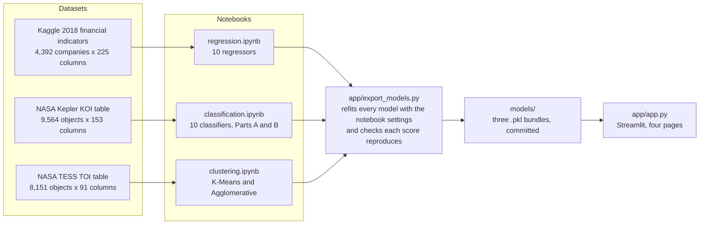

Every supervised notebook follows the same order, and the clustering notebook
mirrors it without a split or a target:

```mermaid
flowchart TD
  subgraph sup["Supervised tracks"]
    S1["Load and audit<br/>shape, dtypes, missing values, target mix"] --> S2["EDA<br/>distributions, correlations, target plots"]
    S2 --> S3["Cleaning and feature engineering<br/>drop leakage columns, one engineered feature"]
    S3 --> S4["Stratified 80/20 split, random_state 42<br/>pipeline per model: median imputation and scaling<br/>fitted on training folds only"]
    S4 --> S5["Baseline run, then GridSearchCV with 5 folds<br/>regression on R2, classification on weighted F1"]
    S5 --> S6["One evaluation on the held-out test set<br/>comparison table, figures, final model chosen by cross-validation"]
  end
  subgraph clu["Clustering track"]
    K1["Load and audit, labels set aside<br/>EDA on 11 physical measurements"] --> K2["log10, clip at the 1st and 99th percentile,<br/>median imputation, standardise"]
    K2 --> K3["K-Means sweep, k = 2 to 10<br/>elbow, silhouette, Davies-Bouldin, Calinski-Harabasz"]
    K2 --> K4["Agglomerative, Ward, complete and average linkage<br/>dendrograms, cuts at k = 2 to 6"]
    K3 --> K5["Metrics comparison, PCA and t-SNE views<br/>labels read in afterwards to describe each cluster"]
    K4 --> K5
  end
```

## Repository structure

```text
.
├── README.md
├── requirements.txt
├── .streamlit/config.toml       # theme for the Streamlit app
├── data/                        # raw CSVs (not committed), see data/README.md
├── notebooks/
│   ├── regression.ipynb
│   ├── classification.ipynb
│   ├── clustering.ipynb
│   └── figures/                 # saved plots, one folder per model plus Comparison/
├── models/                      # saved model bundles (.pkl), built by app/export_models.py
└── app/
    ├── app.py                   # Streamlit interface
    └── export_models.py         # rebuilds models/ with the notebooks' exact preprocessing
```

## Regression track

**Problem statement.** Given a US company's annual financial statement data
(income statement, balance sheet, cash flow and derived ratios), predict the
percentage change in its share price over the following year.

**Dataset.** [200+ Financial Indicators of US Stocks (2014-2018)](https://www.kaggle.com/datasets/cnic92/200-financial-indicators-of-us-stocks-20142018)
on Kaggle (cnic92). We use the 2018 file: 4,392 companies and 225 columns. The
target is `2019 PRICE VAR [%]`, the price variation during 2019. The `class`
column is excluded as a feature because it is derived from the target. Place the
file at `data/2018_Financial_Data.csv` (it is not committed).

**Pipeline.** Drop near-empty columns, keep 41 curated non-redundant indicators,
winsorise at the 1st/99th percentile, stratified 80/20 split (`random_state=42`),
one-hot encode `Sector`, median imputation and scaling fitted on the training
split only, and one engineered feature
(`Growth Adjusted Margin = Revenue Growth x Net Profit Margin`).

**Results.** Held-out test set, identical split for every model, ranked by R2.

| Model | R2 | RMSE | MAE |
|---|---|---|---|
| Random Forest Regressor | 0.111 | 45.53 | 31.96 |
| Gradient Boosting Regressor | 0.100 | 45.80 | 31.90 |
| ElasticNet Regression | 0.040 | 47.30 | 33.32 |
| Ridge Regression | 0.039 | 47.33 | 33.36 |
| SVR | 0.039 | 47.33 | 31.99 |
| Lasso Regression | 0.038 | 47.34 | 33.36 |
| Decision Tree Regressor | 0.037 | 47.38 | 33.30 |
| KNN Regressor | 0.036 | 47.40 | 32.84 |
| Linear Regression | 0.034 | 47.45 | 33.47 |
| Polynomial Regression | 0.016 | 47.89 | 33.15 |

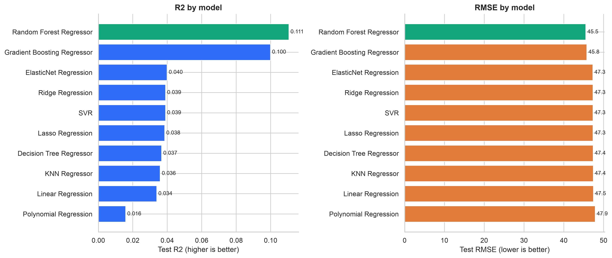

5-fold cross-validated R2 for the top two models: Random Forest 0.061,
Gradient Boosting 0.074. Every model lands at a low R2, which is the honest
finding for this problem: annual fundamentals explain only a small share of
next-year price moves, and the tree ensembles capture the most of what is there.

## Classification track

**Problem statement.** Classify a Kepler Object of Interest as CONFIRMED,
CANDIDATE or FALSE POSITIVE from its transit signal and host-star measurements.

**Dataset.** [NASA Kepler Objects of Interest](https://data.nasa.gov/dataset/kepler-objects-of-interest-koi)
cumulative table: 9,564 objects and 153 columns. The notebook downloads the CSV
automatically from the Exoplanet Archive and saves it to `data/kepler_koi.csv`
(not committed). The target is `koi_disposition`; the disposition score and the
false-positive flags are excluded from the features to avoid leakage.

**Pipeline.** 99 numeric features including an engineered `transit_depth_per_hour`,
stratified 80/20 split, median imputation and standard scaling inside each model
pipeline (fitted on training folds only), weighted precision/recall/F1 and
one-vs-rest ROC-AUC. Every classifier sits behind the same preprocessing steps,
so inside cross-validation each fold refits them on its own training part:

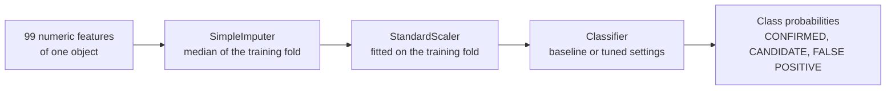

**Results, Part A.** Held-out test set, ranked by weighted F1.

| Model | Accuracy | Weighted F1 | ROC-AUC (OvR) |
|---|---|---|---|
| Support Vector Classifier | 0.822 | 0.820 | 0.944 |
| Decision Tree (tuned) | 0.821 | 0.819 | 0.923 |
| Logistic Regression | 0.820 | 0.813 | 0.937 |
| Decision Tree (baseline) | 0.793 | 0.794 | 0.838 |
| K-Nearest Neighbors (tuned) | 0.785 | 0.782 | 0.913 |
| K-Nearest Neighbors (baseline) | 0.774 | 0.771 | 0.901 |
| Gaussian Naive Bayes | 0.614 | 0.619 | 0.877 |

**Results, Part B.** Same split and metrics. Random Forest was tuned over
`n_estimators`, `max_depth` and `min_samples_split`, AdaBoost over `n_estimators`
and `learning_rate`, Gradient Boosting over `n_estimators` and `learning_rate`,
Bagging over `n_estimators`, `max_samples` and `max_features` (100 trees on half the features won), and the MLP over hidden layer sizes, activation
and the L2 penalty, all with 5-fold GridSearchCV on weighted F1.

| Model | Accuracy | Weighted F1 | ROC-AUC (OvR) |
|---|---|---|---|
| Gradient Boosting (baseline) | 0.864 | 0.861 | 0.963 |
| Random Forest (baseline) | 0.863 | 0.860 | 0.962 |
| Random Forest (tuned) | 0.864 | 0.859 | 0.963 |
| Gradient Boosting (tuned) | 0.856 | 0.853 | 0.961 |
| Bagging (tuned) | 0.857 | 0.853 | 0.961 |
| Bagging (baseline) | 0.844 | 0.844 | 0.947 |
| AdaBoost (tuned) | 0.830 | 0.826 | 0.930 |
| MLP Classifier (tuned) | 0.818 | 0.812 | 0.944 |
| AdaBoost (baseline) | 0.807 | 0.802 | 0.922 |
| MLP Classifier (baseline) | 0.805 | 0.804 | 0.928 |

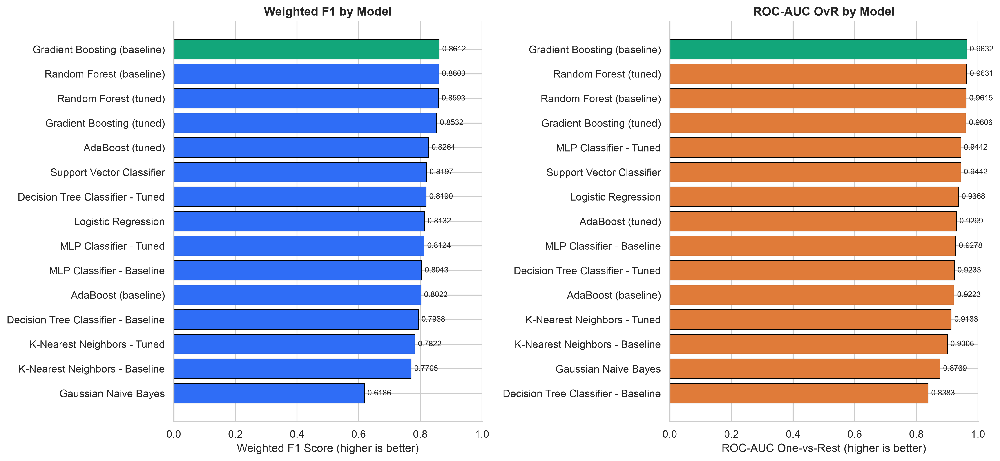

Section 24 of the notebook holds the consolidated table of every run, and
Section 25 reduces it to one row per algorithm (the ten-algorithm table with
accuracy, weighted precision, recall, F1 and ROC-AUC).

**Final model.** The tuned Random Forest (300 trees, max depth 20, min samples
split 5) is the final classifier. It was chosen by 5-fold cross-validation on
the training rows, where it has the highest weighted F1 of all ten algorithms
(0.8473, std 0.0062; tuned Bagging 0.8453, default Gradient Boosting 0.8437,
the Part A winner SVC 0.8193). Tuning raised its CV weighted F1 from 0.8425 for
the default forest to 0.8473 and its held-out ROC-AUC from 0.962 to 0.963. On
the test set it scores accuracy 0.864, weighted F1 0.859 and ROC-AUC 0.963, up
from 0.822, 0.820 and 0.944 for the SVC. The default Gradient Boosting edges it
by 0.002 F1 on this one split but scores lower in cross-validation, so it is
reported, not chosen.

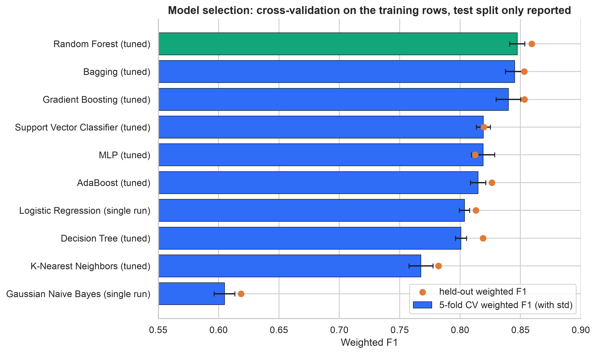

## Clustering track

**Problem statement.** Group TESS Objects of Interest (transit-like signals found
by the TESS space telescope) into natural clusters using only their physical
measurements, with no labels during fitting. The TFOPWG disposition (planet
candidate, confirmed or known planet, false positive, false alarm) is used only
afterwards to read what each cluster contains.

**Dataset.** [NASA TESS Objects of Interest (TOI)](https://exoplanetarchive.ipac.caltech.edu/cgi-bin/TblView/nph-tblView?app=ExoTbls&config=TOI)
from the Exoplanet Archive: 8,151 TOIs and 91 columns at download (19 Oct 2026;
the live table grows over time). The notebook downloads it automatically to
`data/tess_toi.csv` (not committed) from the archive's direct CSV link:
<https://exoplanetarchive.ipac.caltech.edu/TAP/sync?query=select+*+from+toi&format=csv>

**Pipeline.** Eleven physical measurements (orbital period, transit duration and
depth, planet radius, insolation, equilibrium temperature, TESS magnitude, star
distance, temperature, surface gravity and radius). The seven heavy-tailed ones
are log10-transformed, every feature is clipped at the 1st/99th percentile,
missing values take the column median, and everything is standardised. No
train/test split: clustering has no target to hold out.

**Choosing k and the cut.** K-Means was swept from k = 2 to 10; the
Agglomerative trees were built with Ward, complete and average linkage and cut
at k = 2 to 6, keeping only cuts where every cluster holds at least 5% of the
objects and then taking the best silhouette.

<p align="center">
  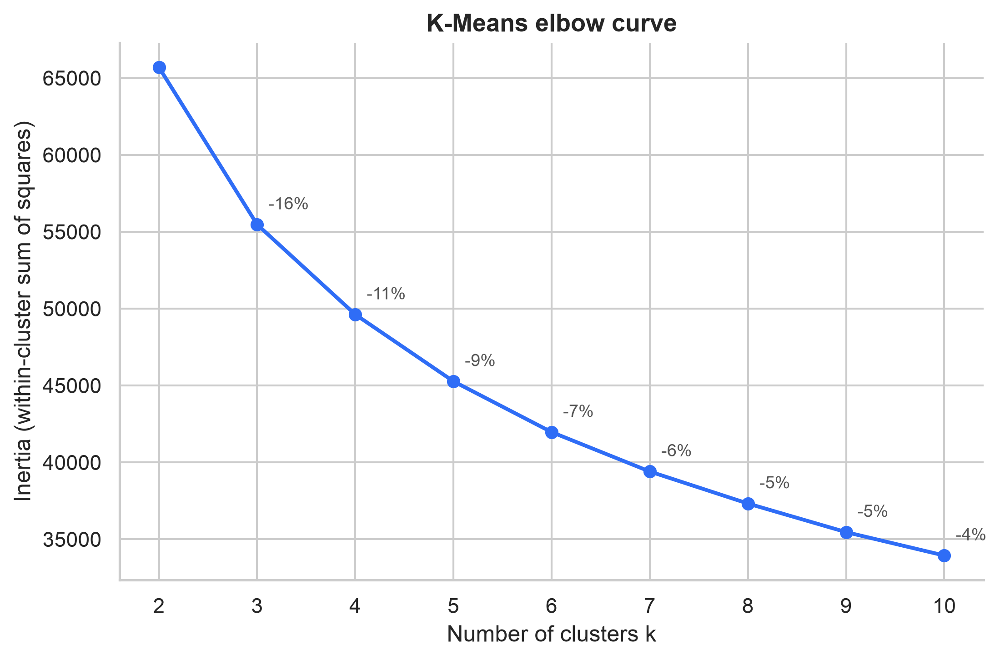
  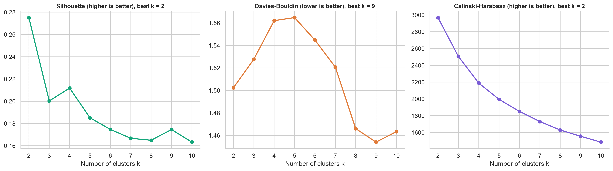
</p>

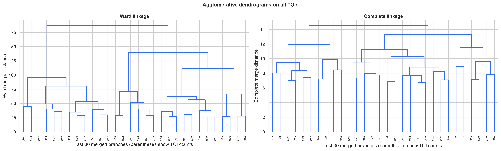

**Results.** K-Means with k = 2, chosen because silhouette (0.275) and
Calinski-Harabasz (2,969) both peak there, Davies-Bouldin (1.50) is nearly flat
across k, and the elbow has no sharp bend. The two clusters are small planets around nearby, cool,
compact stars (34% of TOIs, 28.6% of them confirmed or known planets) and
Jupiter-sized signals around distant, hotter, larger stars (66%, 20.4% false
positives, where about 80% of all false positives land). Complete-linkage
Agglomerative clustering with k = 2 scores silhouette 0.194, Davies-Bouldin
1.84 and Calinski-Harabasz 1,777. The notebook includes Ward and complete
dendrograms, linkage comparisons, cluster profiles, t-SNE and two-algorithm plots.

| Clustering model | Clusters | Silhouette | Davies-Bouldin | Calinski-Harabasz |
|---|---:|---:|---:|---:|
| K-Means | 2 | 0.2752 | 1.5024 | 2,969 |
| Agglomerative (complete linkage) | 2 | 0.1943 | 1.8368 | 1,777 |

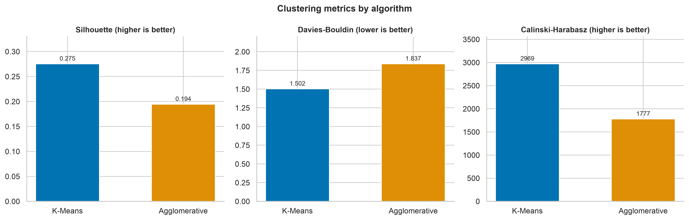

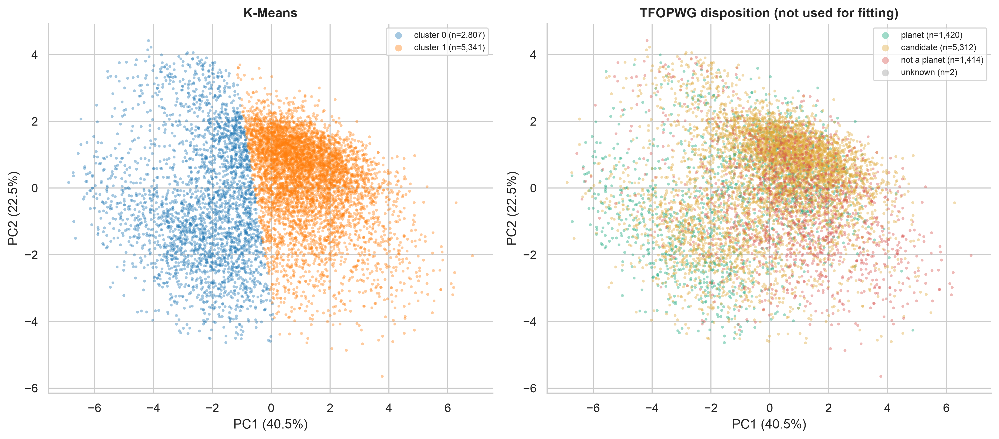

## Setup

```bash
python3 -m venv .venv
source .venv/bin/activate
pip install -r requirements.txt
```

Put the datasets in `data/` (see `data/README.md`), then open the notebooks and
run every cell top to bottom:

```bash
jupyter notebook
```

## Interactive app (Streamlit)

A web interface serves all ten regressors for next-year stock returns, every
classifier run for Kepler objects (Parts A and B), and both clusterings of TESS
objects. The supervised pages have a model selector (the notebook's selected
model is chosen by default) and an "All models" view that scores the
same inputs with every model at once; the clustering page switches between
K-Means, with a k selector covering the notebook's whole sweep, and the
complete-linkage Agglomerative cut at k = 2.

```bash
python app/export_models.py   # rebuilds models/ using the notebooks' exact preprocessing
streamlit run app/app.py
```

`app/export_models.py` needs both datasets in `data/`. It refits every model
with the hyperparameters the notebooks' grid searches picked, checks that each
one reproduces the notebook's held-out score, and saves them together with
everything the app draws from: training medians and percentiles, per-class
typical values, each model's confusion matrix, per-class scores and test-set
predictions, sector statistics and a sample of training objects. The app loads
these from `models/`, so it runs without the raw datasets. The bundles are
committed so the deployed app can load them.

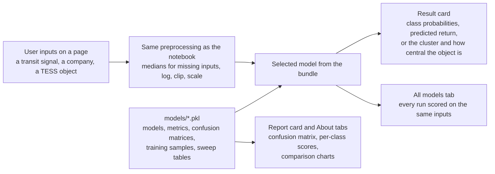

Pages:

- **Exoplanet classifier** (space-themed banner): pick a classifier, enter a transit
  signal and host-star measurements, get the predicted disposition with class
  probabilities, then see the object among 2,500 known Kepler objects, a radar
  comparison with typical objects of each class, what every classifier says about
  the same object, and the selected model's confusion matrix and per-class scores.
- **Stock return predictor**: pick a regressor, enter a company's fundamentals and
  sector, get the predicted next-year change on a dial, then see where it lands
  among the training companies, how much each input moves the prediction
  (one-at-a-time sensitivity), what every regressor predicts, typical returns by
  sector, and the selected model's actual-vs-predicted on the held-out set.
- **TESS cluster explorer** (sky-survey banner): pick K-Means (any k from 2 to
  10) or Agglomerative clustering (the complete-linkage cut at k = 2), enter a
  signal's eleven measurements, see which cluster it joins and how central it
  is, then the object among the 8,151 TESS objects in PCA space, the elbow and
  metric curves used to choose k or the dendrogram and three-linkage sweep used
  to choose the cut, the cluster profiles, a side-by-side metrics comparison of
  the two reported models, and what each cluster contains once the dispositions
  are read in afterwards. Agglomerative clustering has no predict step, so a new
  object is placed with the nearest cluster mean, and the page says so.
- **About the models**: datasets, preprocessing, the full comparison charts and tables
  for all tracks, and run instructions.

The sidebar has a dark/light toggle. It switches Streamlit's theme at runtime
for the whole app (the setting is process-wide, so every open tab follows the
last toggle). Fonts are loaded from jsDelivr; without internet the app falls
back to the system font and still works.

### Deployment (Streamlit Community Cloud)

The three model bundles in `models/` are committed (they are the only `.pkl`
files not ignored), so the app deploys straight from this repository without
the raw datasets. On [share.streamlit.io](https://share.streamlit.io) choose
this repository, branch `main`, main file `app/app.py`, and Python 3.13 under
advanced settings. `requirements.txt` pins scikit-learn to 1.9.0 and pandas
below 3.0, the versions the models were saved with, so they load without
version warnings. Rebuild the bundles only from an environment installed with
`pip install -r requirements.txt`: a bundle saved with a newer pandas cannot be
unpickled by the deployed app at all.

## Reproducibility notes

- `random_state=42` everywhere, with a consistent stratified 80/20 split within each track.
- All scalers, encoders and imputers are fitted on the training split only.
- Every notebook runs top to bottom without errors; figures are saved under `notebooks/figures/`.
- The TOI table is live and grows over time. All clustering results, figures and the app bundle use
  the same 19 Oct 2026 download (8,151 rows); a fresh download will shift counts and scores slightly.

## AI Assistance Disclosure

Generative AI/Codex was used for code scaffolding and development assistance.
Dataset interpretation, analytical observations, feature-engineering
justification, and review/viva explanations must be completed and verified by
the student team.
